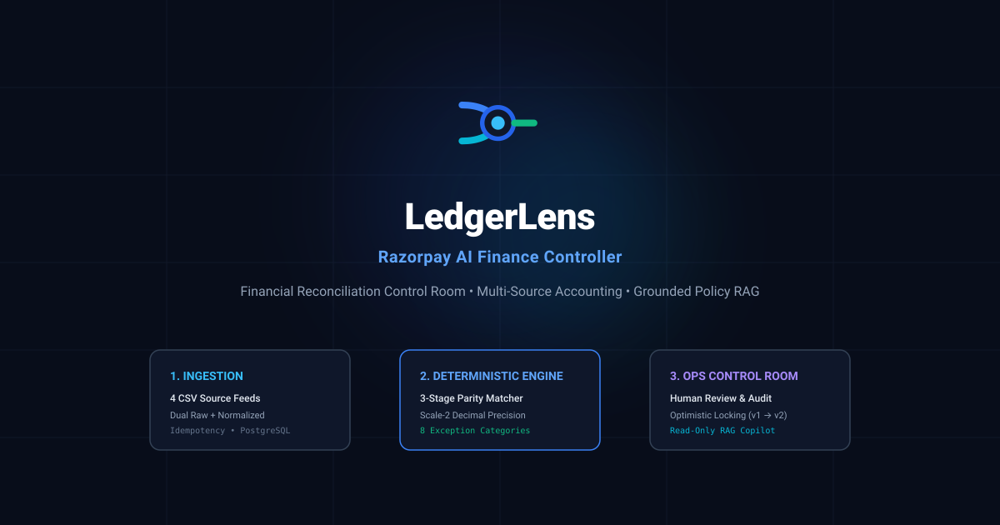
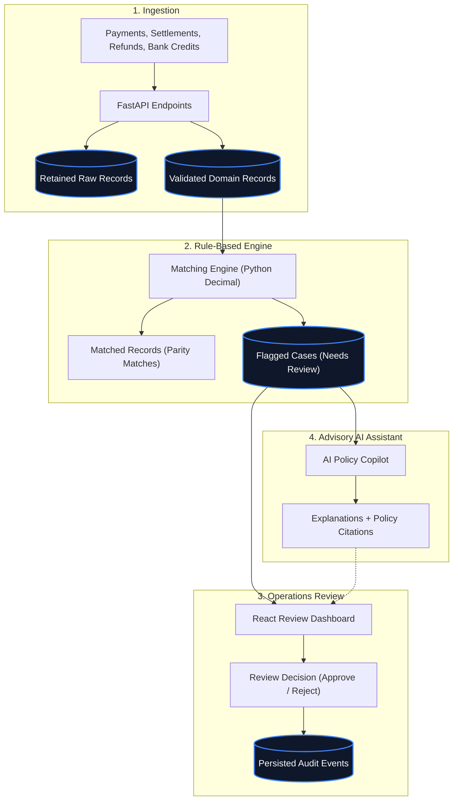
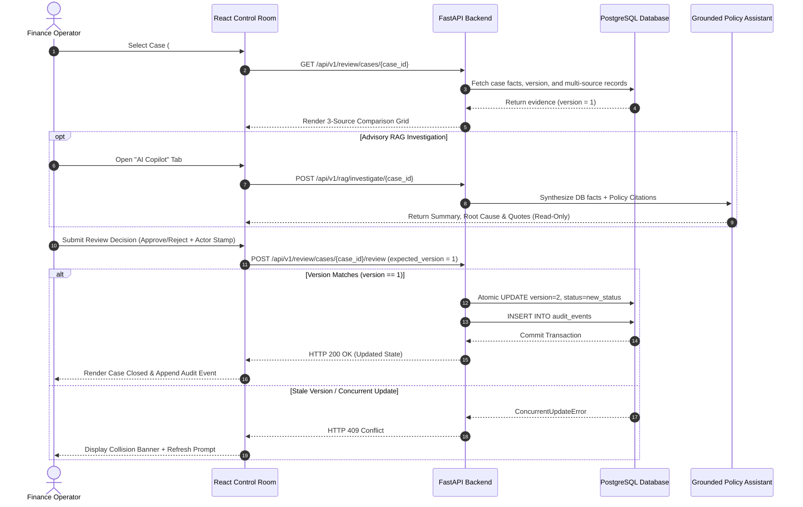

<div align="center">
  
  <h1>LedgerLens</h1>
  <p><strong>Financial Reconciliation Control Room</strong></p>
  <p>Four financial sources. Deterministic matching. Human-reviewed exceptions.</p>

  [](https://github.com/Sathvik1533/razorpay-ai-finance-controller/actions)
  
  
  
  

  <br />
  
</div>

---

## 1. Problem

Financial reconciliation breaks down when customer payments, payment gateway reports, refund records, and bank statements disagree. Common issues include unexpected fees, partial refunds, missing settlement batches, and unlinked bank credits.

Many modern AI tools attempt to match transactions by feeding raw numbers into Large Language Models. This approach is risky because language models can make arithmetic mistakes and invent plausible-sounding values.

---

## 2. What LedgerLens Does

The LedgerLens mark represents four financial data sources converging through an inspection point into a traceable reconciliation outcome. It is a visual metaphor for the system’s role; it does not represent an automated approval.

LedgerLens keeps financial matching strictly rule-based while using AI only to help humans understand flagged issues:

- **Four-Source Matching**: Ingests and compares payments, settlements, refunds, and bank credits.
- **Accurate Money Handling**: Money is handled to exactly two decimal places using Python `Decimal` and PostgreSQL `numeric(18,2)`, avoiding floating-point rounding errors.
- **Original + Clean Storage**: Retains original uploaded data alongside validated, structured records across 13 application tables.
- **Human-in-the-Loop Review**: Discrepancies are routed to an operations dashboard where human reviewers investigate line items and make the final call.
- **AI Investigation Tool**: When a case is flagged, an AI assistant reads the transaction facts and relevant policy notes to explain the root cause with source citations.
- **Collision Protection**: If two reviewers open the same case, only the first submitted decision is saved; the second reviewer is prompted to refresh before deciding.
- **Audit History**: Every approved, rejected, or unresolved decision is saved with reviewer identity, timestamp, and notes.

---

## 3. How It Works


<sub>View the editable diagram source: [`docs/assets/architecture-overview.mmd`](docs/assets/architecture-overview.mmd)</sub>

---

## 4. Built for Safe Review

| Responsibility | Handled By | Why |
|---|---|---|
| **Math & Matching** | Python `Decimal` & PostgreSQL | Ensures exact calculations with no AI hallucination risk |
| **Data Retention** | PostgreSQL raw JSONB + typed tables | Keeps original input safe while powering clean queries |
| **Review Decisions** | Human operators via React UI | Maintains accountability for all financial status changes |
| **Concurrent Reviews** | Case versioning (`expected_version`) | Prevents reviewers from accidentally overwriting each other |
| **Case Explanations** | Read-only AI with policy search | Helps operators understand why an anomaly happened faster |
| **Decision History** | Audit events table | Tracks who decided what, when, and why |


<sub>View the editable diagram source: [`docs/assets/review-workflow.mmd`](docs/assets/review-workflow.mmd)</sub>

---

## 5. Evidence It Works

We test the system against a reproducible 60-record multi-source synthetic evaluation dataset (seed `42`):

| Metric | Target | Result | Status |
|---|---|---|---|
| **Clean Auto-Reconciliation** | 70.0% (42 / 60) | **70.00%** | Matched correctly |
| **Auto-Reconcile Precision** | 100.0% | **100.00%** | 0 false approvals |
| **Auto-Reconcile Recall** | 100.0% | **100.00%** | 0 missed clean matches |
| **Exception Isolation** | 18 anomalies flagged | **18 / 18 Flagged** | All anomalies caught |
| **Input Validation** | 1 malformed row rejected | **1 Rejected (60/61)** | Invalid format blocked |

Version-controlled benchmark outputs:
- JSON Report: [`artifacts/evaluation/reconciliation_benchmark_report.json`](artifacts/evaluation/reconciliation_benchmark_report.json)
- Metrics CSV: [`artifacts/evaluation/reconciliation_metrics_summary.csv`](artifacts/evaluation/reconciliation_metrics_summary.csv)

---

## 6. Try It Locally

### Prerequisites
- Docker & Docker Compose
- Python 3.11+
- Node.js 18+ and npm

### 1. Start Backend API & Database
```bash
make up
docker compose exec api alembic upgrade head
```
Interactive API docs will be at `http://localhost:8000/docs`.

### 2. Start Frontend Dashboard
```bash
cd frontend
npm install
npm run dev
```
The UI starts at `http://localhost:5173`.

### 3. Run Full Automated Test Suite
```bash
make test-ci
```
Spins up an isolated PostgreSQL test container on port 5433, runs all 40 tests, and cleans up.

---

## 7. Follow the Code

| Area | What It Does | Key Code |
|---|---|---|
| **Upload and validation** | Accepts and validates CSV files | [`backend/app/services/ingestion_service.py`](backend/app/services/ingestion_service.py) |
| **Matching rules** | Compares the four financial sources | [`backend/app/domain/matcher.py`](backend/app/domain/matcher.py) |
| **Money calculation** | Calculates fee, tax, and expected net settlement | [`backend/app/domain/settlement_calc.py`](backend/app/domain/settlement_calc.py) |
| **Case persistence** | Stores review cases and candidate matches | [`backend/app/repositories/reconciliation_repo.py`](backend/app/repositories/reconciliation_repo.py) |
| **Review safety** | Rejects stale review decisions (HTTP 409) | [`backend/app/repositories/review_repo.py`](backend/app/repositories/review_repo.py) |
| **AI investigation** | Reads evidence and local policy notes | [`backend/app/rag/assistant.py`](backend/app/rag/assistant.py) |
| **Workflow test** | Proves upload → match → review → audit loop | [`tests/e2e/test_financial_workflow_e2e.py`](tests/e2e/test_financial_workflow_e2e.py) |

---

## 8. Deeper Documentation

For reviewers and engineers who want deeper technical details:

- [Architecture Reference](docs/ARCHITECTURE.md): Database schema (13 tables), ingestion pipelines, and RAG grounding design.
- [Architectural Decision Records (ADRs)](docs/design-decisions.md): Trade-offs behind Decimal math, optimistic locking, and read-only AI.
- [Evaluation Methodology](docs/evaluation.md): Deep-dive into dataset generation, anomaly distributions, and benchmark metrics.
- [Demo Walkthrough Script](docs/demo-script.md): 5-minute technical pitch and demonstration guide.

---

## 9. Known Limitations

- **Batch CSV Only**: Processes batch CSV uploads; real-time Kafka or banking webhook streams are not implemented.
- **Advisory AI**: The AI assistant explains discrepancies with policy citations; it cannot approve cases or initiate money transfers.
- **Single-Tenant**: Designed as an internal operations dashboard for single-team reconciliation.

---

## 10. Project Context & License

LedgerLens is a student-built technical project. It is not affiliated with, endorsed by, or connected to Razorpay or any financial institution.

Distributed under the MIT License. See `LICENSE` for details.
