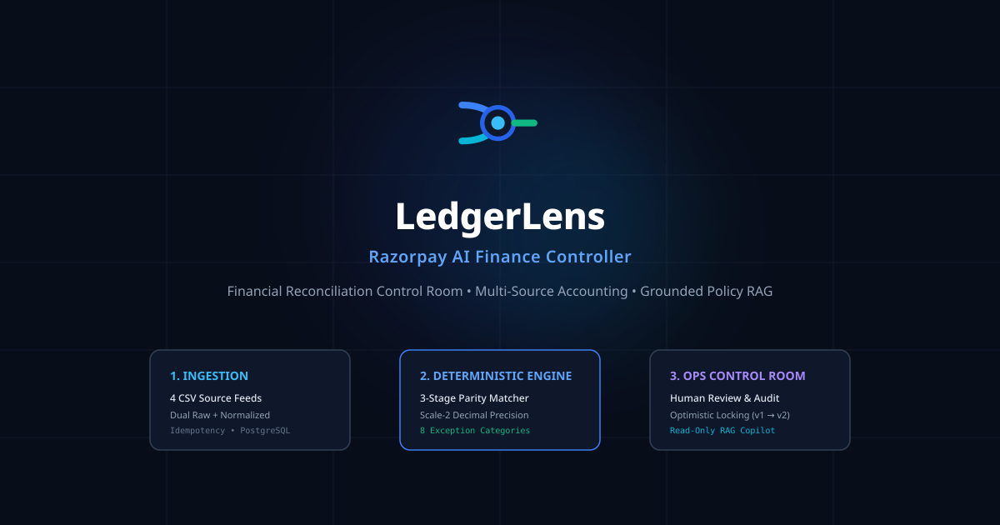
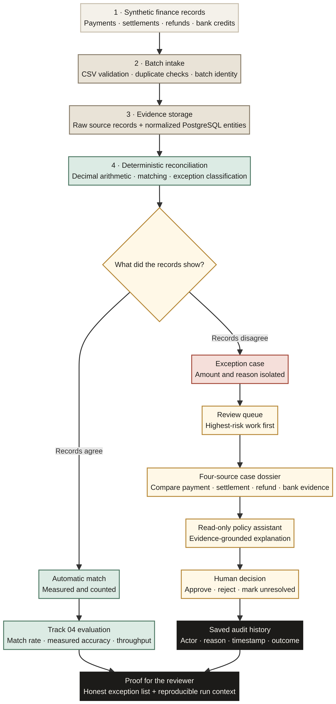

<div align="center">
  
  <h1>LedgerLens</h1>
  <p><strong>Evidence-first financial reconciliation for the AI Finance Controller track</strong></p>
  <p>LedgerLens finds where payment, settlement, refund, bank, and ledger records stop agreeing — then gives a human reviewer the evidence to decide what happens next.</p>

  <br />
  
</div>

[](https://www.python.org/)
[](https://fastapi.tiangolo.com/)
[](https://www.postgresql.org/)
[](https://react.dev/)
[](https://www.typescriptlang.org/)
[](LICENSE)

> **Project status:** LedgerLens is a student-built prototype. The repository is intentionally private while the authenticated workflow, production deployment, and final Track 04 evidence are being completed.

## The idea in one minute

Financial teams often have several records for the same payment. The payment gateway says one thing, the settlement file says another, a refund changes the expected amount, and the bank statement may show a different credit. Finding the exact disagreement is still a manual process.

I built LedgerLens to close one focused finance-operations loop:

> **Records enter → LedgerLens checks them → a mismatch is isolated → evidence explains it → a human decides → the audit history remembers.**

The product is designed for the **AI Finance Controller** track. It works over a synthetic batch of more than 50 records, measures automatic matching, reports throughput and accuracy, and lists the exceptions that still need human attention.

## What a reviewer should see

A complete LedgerLens walkthrough should take a reviewer through one believable story:

1. A synthetic batch of payment, settlement, refund, bank-credit, and ledger records enters the system.
2. Deterministic rules calculate the expected financial relationships.
3. Evaluation reports the batch size, match-rate formula, measured accuracy, throughput, and exceptions.
4. The review queue highlights the problems that need attention first.
5. A case dossier compares the four source streams and shows the amount at risk.
6. The evidence and policy context explain why the records disagree.
7. A human reviewer records a decision and a short reason.
8. The audit history preserves what happened, who decided, and when.

The important point is that LedgerLens does not stop at “the model found an anomaly.” It connects the anomaly to source records, a human decision, and an auditable outcome.

## Why the numbers can be trusted

LedgerLens follows a **deterministic first, AI second** rule.

The deterministic engine owns financial truth. It performs matching, fee and tax calculations, refund adjustments, discrepancy detection, exception classification, and final reconciliation status using Python `Decimal` arithmetic and PostgreSQL numeric values.

The AI layer is a read-only assistant. It retrieves local policy text and database evidence to help explain a case. It does not calculate the ledger, approve a payment, move funds, or silently change a decision.

| Responsibility | LedgerLens approach |
|---|---|
| Financial arithmetic | Python `Decimal`, rounded to scale 2 |
| Source reconciliation | Multi-stage deterministic matching |
| Exceptions | Eight explicit financial exception categories |
| AI role | Evidence-grounded explanation and policy context |
| Human role | Review and decision on unresolved cases |
| Audit | Persisted review and state-transition events |
| Concurrency | Optimistic version checks with HTTP 409 conflicts |

## Track 04 benchmark

The current benchmark is a deterministic synthetic fixture with a known ground truth. It is designed to satisfy the Track 04 requirement that the system be measured on a real batch rather than one cherry-picked match.

The baseline command is:

```bash
python evaluation/run_benchmark.py --size 60 --seed 42
```

A recent local run produced the following result:

| Metric | Result |
|---|---:|
| Valid payment records processed | 60 |
| Intentionally malformed row blocked | 1 |
| Records matched automatically | 42 |
| Records needing review | 18 |
| Match rate | 70.00% (`42 ÷ 60 × 100`) |
| Automatic-match precision | 100.00% |
| Automatic-match recall | 100.00% |
| False automatic approvals | 0 |
| Measured throughput | 52,612.24 payment records/sec in the local run |
| Amount reconciled | INR 159,933.00 |
| Amount still unexplained | INR 70,907.00 |

The throughput value depends on the machine and execution environment. The benchmark writes its current run artifacts to `artifacts/evaluation/`; those generated files are local outputs and should not be treated as permanent truth unless they are regenerated for the run being reviewed.

The benchmark reports an honest exception list. The current fixture includes amount mismatch, missing bank credit, partial refund not reflected, fee mismatch, duplicate payment, and missing settlement cases. The complete eight-category model also supports duplicate bank credit and ambiguous match categories when they occur.

The next verification step is to run a second fixture, such as:

```bash
python evaluation/run_benchmark.py --size 75 --seed 99
```

The final submission must show that the second fixture changes the backend response and the displayed UI values rather than replaying static frontend numbers.

## Architecture

The following map is intentionally vertical. The earlier wide flowchart was difficult to read on GitHub and on mobile screens, so this version keeps the product story in one readable column while making the deterministic, AI, and human-review boundaries visible.



The editable diagram source is [`docs/assets/ledgerlens-system-map.mmd`](docs/assets/ledgerlens-system-map.mmd).

### How an operator uses LedgerLens

This workflow diagram makes the human review loop visible, including the read-only AI boundary and the optimistic-locking conflict path.


Editable source: [`docs/assets/review-workflow.mmd`](docs/assets/review-workflow.mmd).

### How LedgerLens proves its claims

This evidence map shows how CI, isolated PostgreSQL, test layers, benchmark metrics, and the honest exception export connect to the reviewer proof.


Editable source: [`docs/assets/testing-evidence.mmd`](docs/assets/testing-evidence.mmd).

The repository is organized around clear boundaries:

- `backend/app/domain/` contains deterministic matching and financial calculations.
- `backend/app/services/` coordinates ingestion and reconciliation.
- `backend/app/models/` and `backend/app/repositories/` manage PostgreSQL persistence.
- `backend/app/rag/` contains policy retrieval and the read-only investigation assistant.
- `frontend/src/` contains the React review queue, case detail view, and shared UI components.
- `evaluation/` contains the reproducible benchmark runner and artifact writers.
- `tests/` contains unit, integration, evaluation, concurrency, RAG, and end-to-end workflow tests.
- `docs/` contains the architecture, data contract, evaluation methodology, design decisions, security posture, and demo material.

## Local setup

### Prerequisites

- Docker and Docker Compose
- Python 3.11 or newer
- Node.js 18 or newer
- npm

### Start PostgreSQL and the API

```bash
make up
```

The API is available at `http://localhost:8000`. FastAPI documentation is available at `http://localhost:8000/api/v1/docs`.

### Start the frontend

```bash
cd frontend
npm install
npm run dev
```

The Vite development server is available at `http://localhost:5173` and proxies API requests according to `frontend/vite.config.ts`.

### Run the benchmark

From the repository root:

```bash
python evaluation/run_benchmark.py --size 60 --seed 42
```

### Run the test suite

The CI workflow starts an isolated PostgreSQL 15 database before running the integration, evaluation, and end-to-end suites.

```bash
make test-ci
```

Unit tests can be run separately when the Python development dependencies are installed:

```bash
PYTHONPATH=. pytest -q tests/unit/ tests/evaluation/
```

## Current scope

The current prototype focuses on batch CSV ingestion and exception-first reconciliation for synthetic data. It does not implement streaming Kafka or ISO 20022 feeds, autonomous payout holds, bank-credit clawbacks, or a general-purpose multi-tenant finance platform.

The application is intentionally not described as ready for real money. Before live use, it still needs a full identity provider or hardened authentication system, role-based authorization, tenant isolation, stronger deployment controls, managed secrets, file security limits, operational monitoring, and a compliance review.

The next build milestone is a real but minimal authenticated workflow: public explanatory pages remain open, while financial and operational pages require a server-enforced session. Reviewer and Administrator permissions must be enforced by the backend, and audit events must use the authenticated user as the actor.

## Repository status

| Area | Status |
|---|---|
| Deterministic multi-source reconciliation | Implemented in the current prototype |
| Synthetic 60-record benchmark | Implemented and locally reproducible |
| Honest exception export | Implemented |
| Read-only grounded policy assistant | Implemented and tested in the current prototype |
| Human review and optimistic concurrency | Implemented in the current prototype |
| Real authentication and secure sessions | Next implementation milestone |
| Backend role authorization | Next implementation milestone |
| Dynamic Evaluation UI with fresh no-run state | Required verification milestone |
| Public deployment and final browser evidence | Pending final implementation and verification |
| Public GitHub repository | Intentionally deferred until the prototype is ready |

## Documentation

- [Architecture](docs/ARCHITECTURE.md)
- [Evaluation methodology](docs/evaluation.md)
- [Data contract](docs/DATA_CONTRACT.md)
- [Security and production posture](docs/SECURITY_AND_PRODUCTION.md)
- [UI/UX design system](docs/UI_UX_DESIGN_SYSTEM.md)
- [Design decisions](docs/design-decisions.md)
- [Failure and recovery plan](docs/FAILURE_AND_RECOVERY.md)
- [Five-minute demo script](docs/demo-script.md)
- [Reviewer guide and evidence map](docs/reviewer-guide.md)
- [Research evidence and design rationale](docs/research-evidence.md)
- [Competitor analysis](docs/COMPETITOR_ANALYSIS.md)
- [Track 04 application outline](docs/application-outline.md)

## Project identity

The intended product name is **LedgerLens**. The current repository slug remains `razorpay-ai-finance-controller` while the prototype is being completed. A repository rename will be handled separately after the implementation and deployment links are stable.

LedgerLens is a student-built technical project. It is not affiliated with, endorsed by, or connected to Razorpay or any financial institution. All benchmark data is synthetic.

## License

This project is distributed under the MIT License. See [LICENSE](LICENSE).
