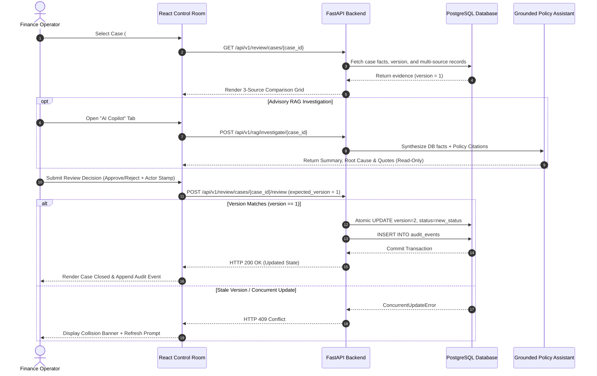
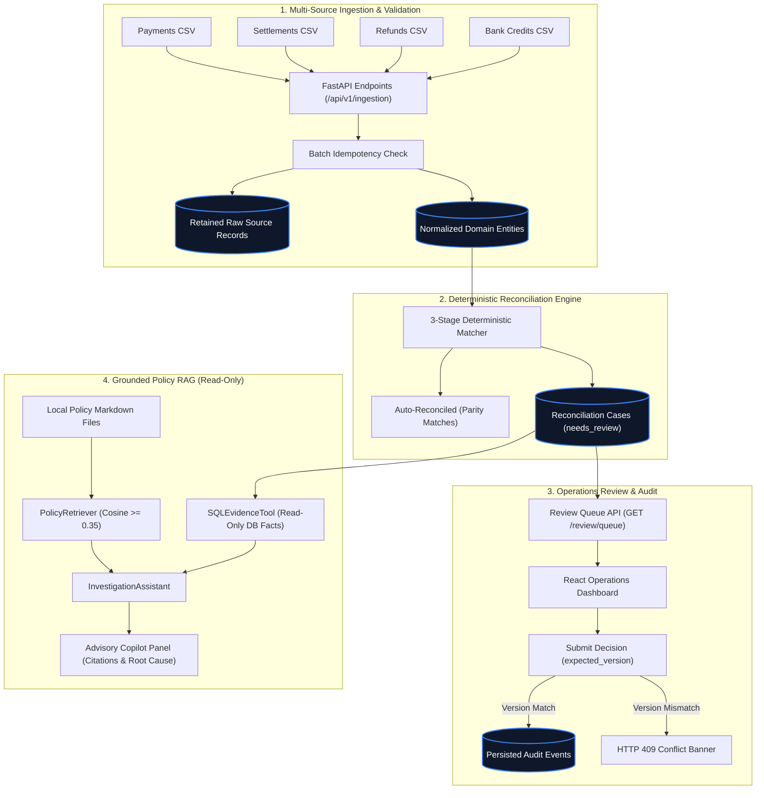
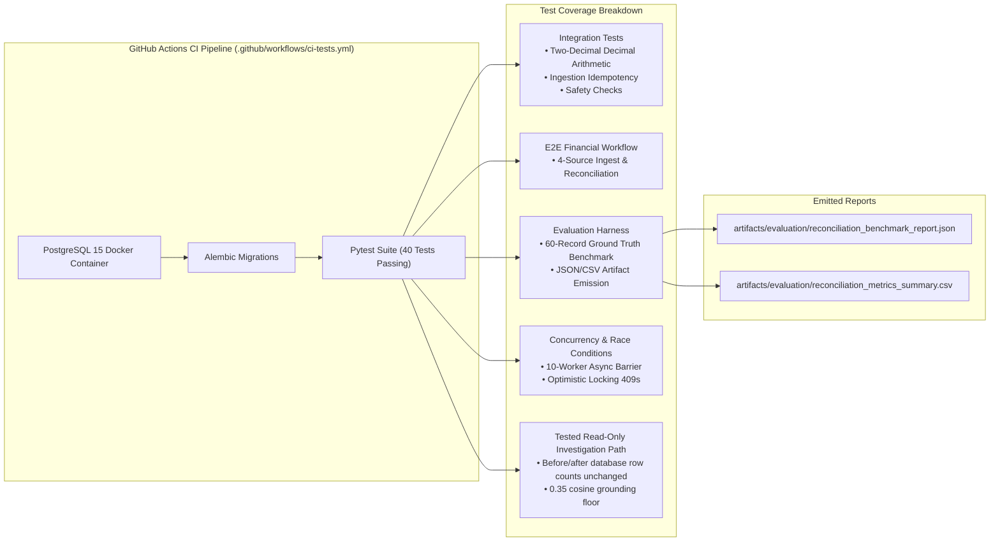

<div align="center">
  
  <h1>LedgerLens &bull; Razorpay AI Finance Controller</h1>
  <p><strong>Financial Reconciliation Control Room & Grounded AI Exception Inspector</strong></p>
  <p>A deterministic multi-source reconciliation engine and human review dashboard for payment operations.</p>

  [](https://github.com/Sathvik1533/razorpay-ai-finance-controller/actions)
  
  
  
  
  
  

  <br />
  
</div>

---

## 1. Problem & Core Philosophy

Financial reconciliation can break down when payment captures, settlement files, refunds, and bank-credit entries disagree. Typical causes include fee differences, partial refunds, missing settlements, and unlinked bank credits.

LedgerLens keeps financial matching deterministic. Python `Decimal` calculations and PostgreSQL-backed records determine the case outcome; the RAG component is limited to explaining evidence and retrieving relevant local policy excerpts.

```text
┌──────────────────────────────────────────────────────────────────────────────┐
│                            LEDGERLENS TRUST BOUNDARY                         │
├──────────────────────────────────────┬───────────────────────────────────────┤
│    DETERMINISTIC PYTHON ENGINE       │       READ-ONLY POLICY RAG COPILOT    │
│    (State, Math, and Enforcement)    │       (Explanation and Guidance)      │
├──────────────────────────────────────┼───────────────────────────────────────┤
│ ✔ Pure Decimal arithmetic (scale=2)  │ ✔ Dense embedding similarity search   │
│ ✔ Multi-source parity matching       │ ✔ Synthesizes DB facts + citations    │
│ ✔ Dual raw + normalized persistence  │ ✔ Cosine grounding floor (>= 0.35)    │
│ ✔ Optimistic locking (versioning)    │ ✘ Not used as reconciliation decider  │
│ ✔ Persisted audit events log         │ ✘ Does not write decisions or ledger  │
└──────────────────────────────────────┴───────────────────────────────────────┘
```

---

## 2. What the System Does

LedgerLens closes an end-to-end financial operations loop:

1. **Multi-Source Batch Ingestion**: Ingests payments, gateway settlements, refunds, and bank credits via REST endpoints with duplicate idempotency checks.
2. **Dual-Layer Persistence**: Preserves raw source payloads in dedicated JSONB tables while writing validated, normalized entities into relational PostgreSQL domain tables.
3. **Deterministic 3-Stage Reconciliation**: Matches transactions across sources using exact scale-2 Decimal arithmetic, automatically approving clean parity matches and isolating 8 distinct financial exception types.
4. **Operations Control Room**: A React dashboard providing exception filtering, 3-way comparative line-item inspection, and optimistic concurrency locking.
5. **Grounded AI Copilot**: A read-only RAG assistant providing citation-aware policy retrieval with confidence signaling without mutating database state.
6. **Persisted Audit Logging**: Successful review actions create persisted audit events with actor identity, timestamps, and state transitions.

---

## 3. Workflow at a Glance



---

## 4. Architecture & Trust Boundaries

The system separates raw ingestion, relational normalization, deterministic matching, and advisory AI into isolated functional layers across 13 PostgreSQL application tables:



---

## 5. Supported Financial Exception Types

| Exception Category | Trigger Condition | Operational Handling |
|---|---|---|
| `amount_mismatch` | Net settlement or gross payment does not match bank credit or settlement line item. | Routed to human review; case records discrepancy breakdown. |
| `missing_settlement` | Payment is captured but no settlement record exists after standard batch cutoff. | Routed to human review; flags missing settlement relationship. |
| `missing_bank_credit` | Gateway reports processed settlement, but no matching bank statement UTR credit is found. | Routed to human review; reviewer investigates unallocated bank statements. |
| `fee_mismatch` | Calculated 2% gateway fee or 18% GST deviates from reported settlement values. | Routed to human review; case isolates fee and tax variance. |
| `duplicate_payment` | Multiple captured payments cite identical order references. | Routed to human review; reviewer investigates duplicate transactions. |
| `duplicate_bank_credit` | Multiple bank statement entries reference the same UTR or settlement ID. | Routed to human review; flags secondary line item for operator triage. |
| `partial_refund_not_reflected` | Customer refund was captured but net settlement payout was not adjusted. | Routed to human review; case records unreflected refund balance. |
| `ambiguous_match` | Multiple settlement candidate lines match a single payment reference. | Matching is suppressed pending human review; candidate matches presented. |

---

## 6. Evaluation Benchmark & Evidence

A deterministic 60-record multi-source synthetic evaluation dataset (seed `42`) validates matching accuracy, anomaly detection, and boundary rejection:

| Benchmark Metric | Ground Truth Target | Measured Result | Status |
|---|---|---|---|
| **Clean Auto-Reconciliation Rate** | 70.0% (42 / 60) | **70.00%** | Verified |
| **Auto-Reconcile Precision** | 100.0% | **100.00%** | 0 False Auto-Approvals |
| **Auto-Reconcile Recall** | 100.0% | **100.00%** | All clean records matched |
| **Exception Isolation** | 18 anomalies flagged | **18 / 18 Flagged** | 0 Unflagged Exceptions |
| **Ingestion Scale Validation** | 1 malformed row rejected | **1 Rejected (60/61)** | Boundary Enforced |

Generated benchmark artifacts are version-controlled:
- Machine-readable JSON report: [`artifacts/evaluation/reconciliation_benchmark_report.json`](artifacts/evaluation/reconciliation_benchmark_report.json)
- Summary CSV metrics: [`artifacts/evaluation/reconciliation_metrics_summary.csv`](artifacts/evaluation/reconciliation_metrics_summary.csv)

---

## 7. Automated Test Suite & CI



The test suite consists of **40 automated tests** passing in GitHub Actions CI:
- **Database & Money Scale**: Validates exact scale-2 numeric rounding and foreign key cascade behavior in PostgreSQL 15.
- **Batch Ingestion & Idempotency**: Asserts identical hash duplicate rejection across all 4 CSV routes.
- **Deterministic Reconciliation**: E2E multi-source matching and case generation.
- **Optimistic Concurrency**: 10-worker async barrier tests asserting `HTTP 409 Conflict` under race conditions.
- **RAG Grounding Invariant**: Confirms zero database mutations during policy investigation and verifies the 0.35 cosine grounding floor.

To run the full test suite locally against an isolated test database container:
```bash
make test-ci
```

---

## 8. Tech Stack

- **Backend**: Python 3.11, FastAPI (`fastapi>=0.110.0`), SQLAlchemy (`sqlalchemy>=2.0.28`), Pydantic (`pydantic>=2.6.0`), Alembic (`alembic>=1.13.1`).
- **Database**: PostgreSQL 15 (`postgres:15-alpine`), `psycopg2-binary`.
- **Advisory AI & Retrieval**: Sentence Transformers (`sentence-transformers>=2.5.1`), Scikit-Learn (`scikit-learn>=1.4.1.post1`), Groq / Gemini API client integration.
- **Frontend Control Room**: React 18 (`react@^18.2.0`), TypeScript 5.2 (`typescript@^5.2.2`), Vite 5.1 (`vite@^5.1.6`), Tailwind CSS (`tailwindcss@^3.4.3`), Lucide Icons (`lucide-react@^0.363.0`).

---

## 9. Quickstart Guide

### Prerequisites
- Docker & Docker Compose
- Python 3.11+
- Node.js 18+ and npm

### 1. Start Database & Backend API
```bash
# Start PostgreSQL and FastAPI backend
make up

# Apply database migrations
docker compose exec api alembic upgrade head
```
The FastAPI documentation will be available at `http://localhost:8000/docs`.

### 2. Start the Frontend Operations Dashboard
```bash
cd frontend
npm install
npm run dev
```
The Vite development server starts at `http://localhost:5173` by default.
The UI expects the FastAPI API to be reachable through the configured Vite proxy or API base URL.

### 3. Run the CI Test Suite
```bash
# Spins up isolated PostgreSQL test container on port 5433, runs all 40 tests, and tears down
make test-ci
```

---

## 10. Repository Map

```text
razorpay-ai-finance-controller/
├── backend/
│   ├── alembic/                    # Database migrations (13 application tables)
│   ├── app/
│   │   ├── api/v1/endpoints/       # REST routes: ingestion, reconciliation, review, rag, health
│   │   ├── core/                   # App configuration & environment settings
│   │   ├── db/                     # SQLAlchemy session & base models
│   │   ├── domain/                 # Deterministic matcher, settlement calculator, exceptions
│   │   ├── models/                 # 13 SQLAlchemy ORM models
│   │   ├── rag/                    # PolicyRetriever, SQLEvidenceTool, Assistant & policy corpus
│   │   ├── repositories/           # Payment, reconciliation, and review data-access layers
│   │   ├── schemas/                # Strict Pydantic v2 validation schemas
│   │   └── services/               # Ingestion and reconciliation orchestrators
│   └── requirements.txt            # Backend dependencies
├── frontend/
│   ├── src/
│   │   ├── api/                    # API client with optimistic locking handling
│   │   ├── components/             # MultiSourceCard, ReviewActionForm, RagCopilotPanel, Badges
│   │   ├── pages/                  # ReviewQueuePage, CaseDetailPage
│   │   └── types/                  # TypeScript domain interfaces
│   ├── package.json                # React 18, Vite 5, Tailwind CSS
│   └── vite.config.ts              # API proxy and build configuration
├── tests/
│   ├── integration/                # Database constraints, scale-2 money, RAG grounding, review API
│   ├── e2e/                        # End-to-end 4-source reconciliation workflow
│   ├── evaluation/                 # 60-record deterministic benchmark harness & artifact tests
│   └── conftest.py                 # Isolated PostgreSQL container fixture & migration runner
├── docs/
│   ├── assets/                     # Architecture diagrams, brand mark, social preview SVG
│   ├── ARCHITECTURE.md             # In-depth technical architecture reference
│   ├── design-decisions.md         # Key Architectural Decision Records (ADRs)
│   ├── evaluation.md               # 60-record benchmark methodology & evaluation schema
│   └── demo-script.md              # 5-minute technical pitch and walkthrough script
├── artifacts/                      # Emitted benchmark evaluation reports (JSON & CSV)
├── docker-compose.yml              # Local development compose file
├── docker-compose.test.yml         # Isolated test database container (port 5433)
├── Makefile                        # Developer & CI command targets (test-ci, up, down)
└── README.md                       # Main project documentation
```

---

## 11. Architectural Decision Records (ADRs)

- **ADR 01: Python `Decimal` and PostgreSQL `numeric(18,2)`**: Eliminates IEEE 754 floating-point rounding errors across financial calculations. [Read details](docs/design-decisions.md#adr-01-python-decimal-and-postgresql-numeric182-for-currency)
- **ADR 02: Deterministic Matching vs. AI Calculation**: Isolates financial arithmetic to deterministic Python rules; restricts LLM to read-only explanations. [Read details](docs/design-decisions.md#adr-02-deterministic-python-engine-vs-generative-ai-for-matching)
- **ADR 03: Optimistic Concurrency Control (`expected_version`)**: Prevents race conditions during concurrent reviewer actions without persistent row locks. [Read details](docs/design-decisions.md#adr-03-optimistic-concurrency-control-expected_version-for-reviews)
- **ADR 04: Read-Only RAG with 0.35 Grounding Floor**: Rejects ungrounded policy citations to prevent hallucinated compliance guidance. [Read details](docs/design-decisions.md#adr-04-read-only-rag-assistant-with-cosine-similarity-grounding-floor)

---

## 12. Known Limitations & Scope Boundaries

- **Batch Ingestion vs. Streaming**: The current release processes batch CSV payloads with duplicate hash idempotency; real-time Kafka or ISO20022 webhook streams are not implemented.
- **Read-Only Advisory AI**: The RAG assistant provides structured root-cause explanations and policy quotes; it does not execute automated payout holds or bank credit clawbacks.
- **Single-Tenant Scope**: Designed as an operations control room for single-tenant payment reconciliation without dynamic multi-tenant RBAC.

---

## 13. Project Context

LedgerLens is a student-built technical project. It is not affiliated with, endorsed by, or connected to Razorpay or any financial institution.

---

## 14. License

Distributed under the MIT License. See `LICENSE` for details.
