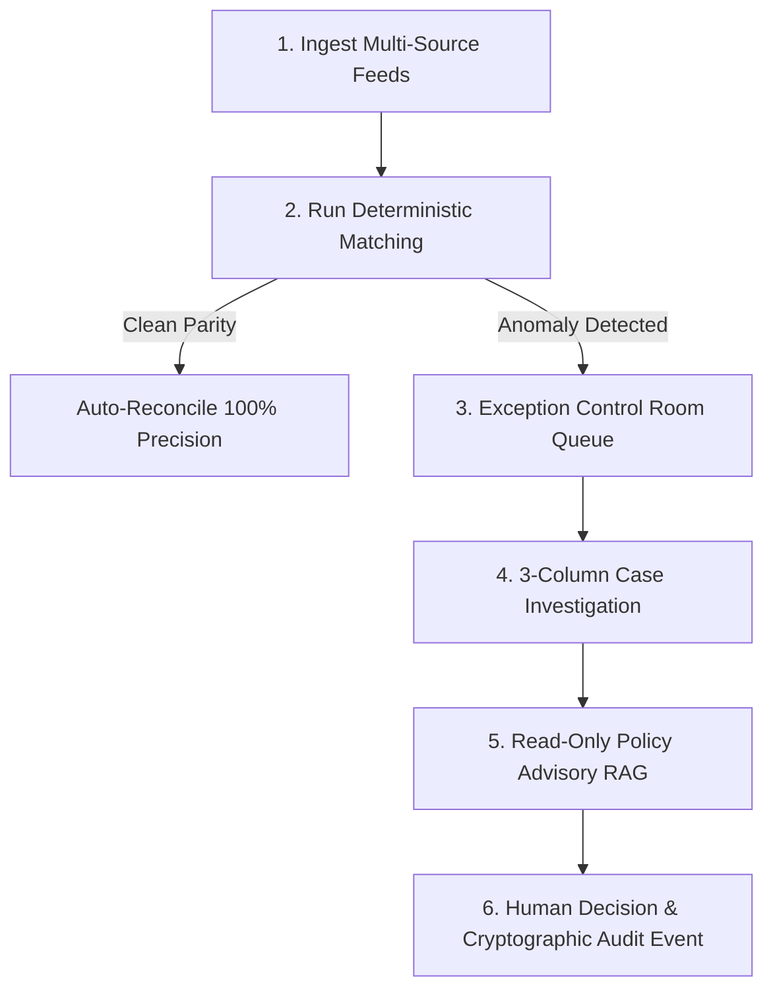

# LedgerLens — Product Vision & Architecture Brief

```text
product_name: LedgerLens (Razorpay AI Finance Controller)
category: B2B Fintech / Multi-Source Financial Reconciliation Control Room
target_audience: Finance Operations Analysts, Controllers, and Compliance Auditors
last_updated: 2026-08-31
```

---

## 1. The Core Problem
Finance teams operating across modern digital economies lose millions to **silent reconciliation errors**:
- Payment gateways capture funds but drop settlement lines.
- Processing fees deviate from negotiated merchant tiers.
- Partial customer refunds are issued but never reflected in net payouts.
- Bank statement credits fail to link with settlement batch UTRs.

Traditional solutions force operators into fragile Excel VLOOKUP workflows, opaque black-box auto-resolvers, or bloated payment-gateway dashboards optimized for merchant marketing rather than anomaly triage.

---

## 2. The Solution: Deterministic Reconciliation + Grounded AI

LedgerLens closes the financial loop through a strict **Trust Boundary**:

1. **4-Source Determinism**:
   - Compares **Captured Payments**, **Gateway Settlements**, **Customer Refunds**, and **Core Bank Credits**.
   - Enforces scale-2 `Decimal` arithmetic in Python and PostgreSQL. IEEE-754 floating-point drift is strictly barred.
2. **Grounded AI Policy Guidance**:
   - A read-only RAG assistant retrieves contractual SOP clauses using `pgvector` dense embeddings.
   - Grounding floor: Cosine similarity $\ge 0.35$.
   - **Safety Invariant**: AI is strictly advisory; it has zero database mutation authority and cannot approve cases.
3. **Human-in-the-Loop Decision Terminal**:
   - Operators make irreversible decisions with mandatory audit justification.
   - Concurrency is protected by atomic Compare-And-Swap (CAS) version locking (`lock_version`).

---

## 3. The 6-Step Operator Journey



1. **Triage Queue**: Operator inspects the Exception Control Room (`/app/queue`) prioritized by monetary exposure.
2. **Investigation**: Operator opens the 3-column workspace (`/app/case/:id`) to compare multi-source feed cards side-by-side.
3. **Policy Context**: Operator reviews verified DB facts and contractual SOP citations.
4. **Accountable Resolution**: Operator selects decision (`Approve`, `Reject`, `Mark Unresolved`), inputs rationale, and submits via atomic CAS.
5. **Immutable Audit**: System records an append-only audit event with actor, timestamp, and version transition.

---

## 4. The Visual & Interaction Philosophy
- **Calm, High-Density Control Room**: Dark midnight canvas (`#080D1A`), high-contrast slate surfaces (`#0F172A`), tabular monospace figures (`JetBrains Mono`).
- **No Marketing Slop**: Zero decorative glowing blobs, glassmorphism filters, or customer onboarding widgets.
- **Above-The-Fold Actionability**: Exception queue appears immediately without oversized KPI walls.
