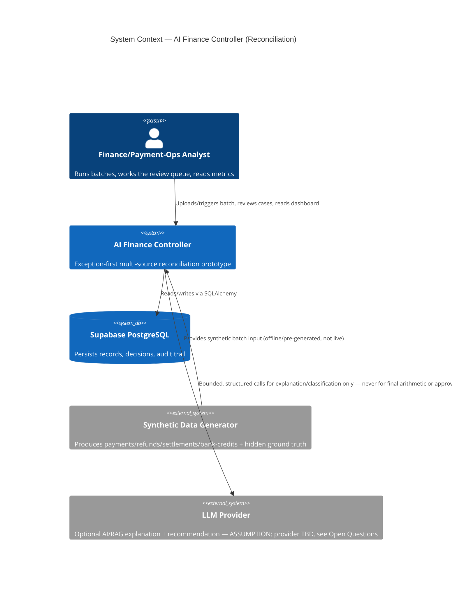
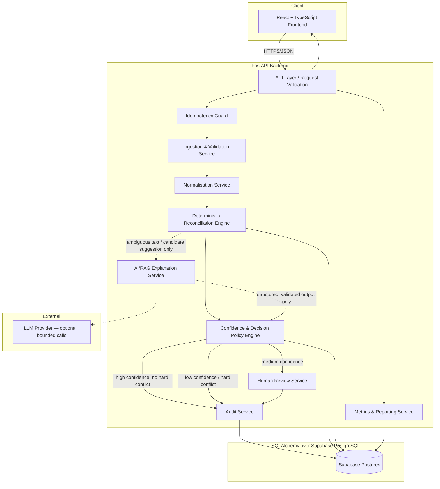
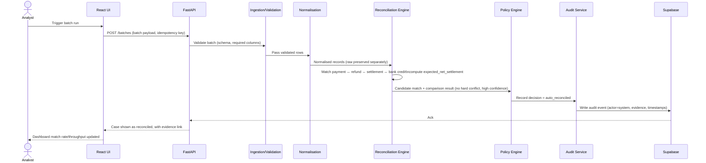
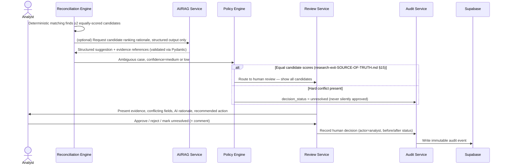
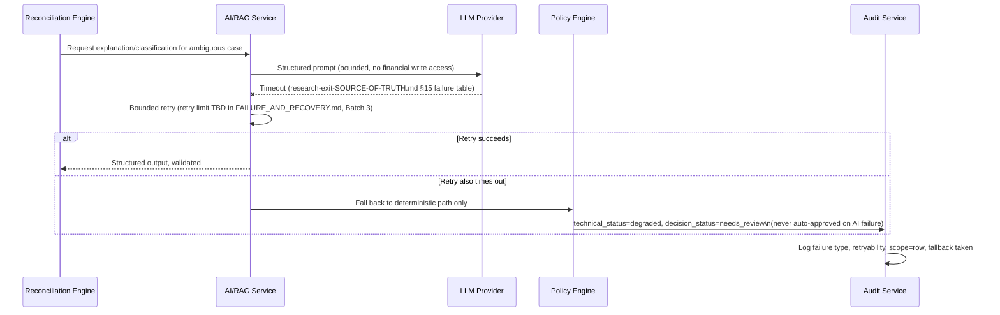

> **Scope guard:** This file implements only the approved MVP workflow — **exception-first multi-source reconciliation** — as defined in `research-exit-SOURCE-OF-TRUTH.md` §4 and `docs/PRD.md` §7/§11. Settlement Q&A, forward cash forecasting, and tax-line matching are **not** architected here; they remain future extensions per `docs/PRD.md` §18, considered only after this MVP's acceptance gate passes. Two distinct sources are cited throughout: the **external official source** (`https://razorpay.com/buildathon/`) and the **internal project source of truth** (`research-exit-SOURCE-OF-TRUTH.md`) — the latter is this project's own record, not the former.

# ARCHITECTURE.md

## 1. System context

The system is a synthetic-data prototype used by a single persona — the finance/payment-operations analyst — to run a reconciliation batch and work a review queue. It is not connected to any real payment rail, real bank, or real merchant account. All four data sources (payments, refunds, settlements, bank credits) are synthetic and generated by a seeded, reproducible generator (`research-exit-SOURCE-OF-TRUTH.md` §9).



5W1H for this context: **Who** — the analyst (only in-scope user; `research-exit-SOURCE-OF-TRUTH.md` §3 explicitly excludes consumers, banks, tax authorities, payroll teams, general accounting users). **What** — one closed reconciliation loop over a batch. **When** — on-demand batch runs, not a continuous stream (ASSUMPTION, consistent with a "batch of at least 50 records" brief). **Where** — a synthetic-data prototype environment, not production. **Why** — to demonstrate throughput, measured accuracy, and an honest exception list, the OFFICIAL evaluation bar. **How** — deterministic engine first, AI/RAG only for explanation and bounded recommendation, SQL as source of truth for money.

## 2. Component diagram



**Note on the dotted edges:** AI/RAG involvement is intentionally drawn as optional/advisory (dotted) — it can suggest candidates and draft explanations, but every solid-line path (validation → normalisation → engine → policy → audit) is fully deterministic and does not depend on AI availability. This directly encodes the requirement that AI must never perform final arithmetic or final approval (`research-exit-SOURCE-OF-TRUTH.md` §12).

## 3. Sequence — normal match



## 4. Sequence — ambiguous match



## 5. Sequence — model timeout



## 6. Component responsibilities

- **React + TypeScript frontend:** displays records, metrics, evidence, and review actions; renders loading/empty/error/AI-unavailable states (per `docs/UI_UX_SPEC.md`, Batch 4 — does not exist yet); sends no direct database or model calls (all traffic via FastAPI).
- **FastAPI backend:** API surface, request/response validation (Pydantic), orchestration of ingestion → normalisation → engine → policy → review → audit → metrics; owns the access boundary — the frontend and any external caller only ever talk to this layer.
- **SQLAlchemy:** ORM layer defining ledger, evidence, audit, and review tables; owns transactional writes, relationships, and query construction; is the only layer permitted to write financial decision fields.
- **Supabase PostgreSQL:** hosted Postgres for the prototype; stores raw records, normalised records, matches, decisions, audit events, and metrics; source of truth for exact financial facts (`research-exit-SOURCE-OF-TRUTH.md` §12).
- **Python deterministic reconciliation engine:** normalisation, matching (exact identifiers → deterministic multi-field → one broader deterministic pass), expected-net-settlement calculation, hard-conflict detection.
- **AI/RAG service:** bounded, structured-output-only calls for ambiguous-text interpretation, candidate suggestions, exception explanation, and recommended-next-action drafting; never writes a financial decision directly.
- **Policy engine:** applies confidence thresholds and hard-conflict rules to produce `decision_status`; the single place where auto-reconcile / needs-review / unresolved is decided, always from deterministic inputs.
- **Human review service:** presents evidence, conflicting fields, and AI rationale; records approve/reject/unresolved actions with actor, timestamp, and comment.
- **Audit service:** append-only log of every decision (system or human), the evidence behind it, and the before/after status.
- **Idempotency guard:** rejects/short-circuits duplicate batch submissions, returning the original result rather than reprocessing.

## 7. Ingestion and validation

Input batches are validated against required columns per source table before any normalisation happens. Missing required CSV columns reject the whole batch (`research-exit-SOURCE-OF-TRUTH.md` §15). Raw values are stored as received, immutably, before any transformation — this preserves an audit-safe original copy distinct from normalised values (`research-exit-SOURCE-OF-TRUTH.md` §7).

**5W1H:** **Who** — the ingestion service, invoked by the API layer. **What** — schema and required-column validation. **When** — first step after a batch is accepted, before normalisation. **Where** — inside the FastAPI backend, before any database write of normalised data. **Why** — a malformed batch must never silently propagate bad data into matching or reporting. **How** — Pydantic schema validation against the contracts in `docs/DATA_CONTRACT.md`; batch-level rejection with a documented reason on failure.

## 8. Normalisation

Normalisation converts raw values into typed, decimal-safe, timezone-aware, currency-explicit records, while preserving the raw row alongside the normalised one (never overwriting raw evidence — `research-exit-SOURCE-OF-TRUTH.md` §7). Source-row identifiers are preserved through normalisation so any normalised record can be traced back to its raw input.

## 9. Deterministic reconciliation engine

Matching proceeds in stages, per `research-exit-SOURCE-OF-TRUTH.md` §10: (1) exact identifiers (`payment_id`, `order_id`, `refund_id`, `settlement_id`, `bank_reference` — strong identifiers; `bank_name` is supporting context only, never a unique key), (2) deterministic multi-field matching, (3) one broader deterministic pass for still-unmatched cases, (4) AI assistance only for ambiguous text/candidate suggestions, (5) confidence and policy decision.

**Payment-to-settlement linkage (corrected):** this is a direct deterministic relationship, `payments.settlement_id → settlements.settlement_id` (`docs/DATA_CONTRACT.md` §2, §6), not a matching-window or grouping heuristic. A null `payments.settlement_id` deterministically represents `missing_settlement` for that payment. Stages (2)–(4) above apply to relationships that are *not* already fixed by a direct FK — e.g. refund-to-payment ambiguity or bank-credit narration interpretation — where genuine candidate scoring is still needed.

Expected net settlement is computed as:

```
expected_net_settlement = captured_payments − refunds − fees − taxes + adjustments
```

Hard conflicts (currency mismatch, materially incorrect amount, contradictory trusted identifiers) always block automatic approval, regardless of confidence score.

## 10. AI and RAG boundary

Deterministic code and SQL MUST handle: schema validation, exact retrieval, joins, amounts, dates, fees, duplicate detection, final confidence policy, final financial status (`research-exit-SOURCE-OF-TRUTH.md` §12).

**Retrieval is split into two tiers — "RAG" is not one monolithic optional component:**

- **SQL-grounded retrieval (mandatory).** Exact lookups against normalised Postgres tables — payments, refunds, settlements, bank credits, and their computed matches — are the *only* source of exact financial evidence (amounts, identifiers, dates, computed `expected_net_settlement`). This applies to every case, AI-assisted or not, and has no dependency on any vector store or document index.
- **Vector/document RAG (optional, deferred).** Retrieval over unstructured text — policy documents, field definitions, prior resolved-case narratives — is an optional enhancement layered on top of the deterministic core once that core works end-to-end. It is **not required for Gate 1**, and **no vector database is provisioned at Gate 1** (see §16, §19). If added later, it may only supply contextual/explanatory material, never exact financial facts.

AI MAY handle: messy narration interpretation, candidate suggestions, exception classification (subject to human/system policy confirmation), plain-language explanation (when available), bounded next-action recommendation. Under either retrieval tier, AI and RAG MUST NOT determine an exact amount, a final match, or a final approval — those are exclusively SQL-grounded and decided by the policy engine (`research-exit-SOURCE-OF-TRUTH.md` §12). All AI output is required-structured (Pydantic-validated); malformed output is rejected and retried once, then routed to review (`research-exit-SOURCE-OF-TRUTH.md` §15). Hidden ground truth never enters a prompt, retrieval document, or UI payload.

## 11. Confidence and decision policy

Four fields are kept explicitly separate and never conflated (`research-exit-SOURCE-OF-TRUTH.md` §13; `resolution_reason` added by the `docs/DATA_CONTRACT.md` §15 correction):

- `confidence`: `high | medium | low | unavailable | not_applicable`
- `decision_status`: `auto_reconciled | needs_review | unresolved | rejected | blocked | already_processed`
- `technical_status`: `success | retrying | degraded | failed | paused`
- `resolution_reason`: `matched | no_candidate_found | multiple_candidates` — the closed set of values locked so far (canonical definition and full open-question status: `docs/DATA_CONTRACT.md` §15/§14.7). Additional values for the `rejected`, `blocked`, and `already_processed` `decision_status` outcomes are not yet fixed and remain a Gate 1 open question there, not invented here.

**`resolution_reason` is distinct from `exception_type`.** `exception_type` (§10 of `docs/DATA_CONTRACT.md`) describes *a financial exception* — one of the eight closed values, or `null` when there is no exception. `resolution_reason` describes *why the case reached its decision outcome* — it disambiguates what a bare `exception_type = null` (or `ambiguous_match`) actually means on its own, since without it "resolved cleanly" and "nothing found" were previously indistinguishable. The two fields answer different questions and neither substitutes for the other:

| Case | `exception_type` | `decision_status` | `resolution_reason` |
|---|---|---|---|
| Normal resolved match | `null` | `auto_reconciled` | `matched` |
| No candidate found after the broader pass | `null` | `unresolved` | `no_candidate_found` |
| Ambiguous candidates | `ambiguous_match` | `needs_review` | `multiple_candidates` |

Policy: high confidence + no hard conflict → `auto_reconciled`. Medium confidence → `needs_review`. Low confidence or any hard conflict → `unresolved`. Confidence `unavailable` → fallback or review; the system never pretends certainty. Thresholds are tuned on validation data and frozen before held-out evaluation (open question — see §22 below and `docs/PRD.md` §17).

## 12. Human review flow

Every exception carries a **deterministic evidence summary and calculated reason** — always present, computed from SQL-grounded facts, independent of AI availability. AI may add a natural-language explanation and a recommended action **when available**; if AI is unavailable, the deterministic summary and calculated reason remain and the case is still safely reviewable (see §10).

The reviewer sees: original records, suggested match, matching fields, conflicting fields, expected amount, actual amount, difference, evidence references, the deterministic evidence summary/calculated reason, the AI explanation and recommended action (when available), and approve/reject/unresolved controls plus a comment field. Every review action records actor, timestamp, previous status, new status, evidence references, AI output (when available), and human comment (`research-exit-SOURCE-OF-TRUTH.md` §14). Full screen-level detail is deferred to `docs/UI_UX_SPEC.md` (Batch 4 — does not exist yet); this section defines only the data/behaviour contract the UI must satisfy.

## 13. Audit trail

Every automated or human decision is written as an audit event (actor, timestamp, previous/new status, evidence references, model/prompt version where applicable). The audit service is the only writer to the audit table.

**Immutability, precisely scoped:** for the prototype, audit events are **append-only by application policy** — the audit service never issues an UPDATE or DELETE against the audit table — but this is an application-level convention, not a database-enforced guarantee. Production requires database-level permissions (no UPDATE/DELETE grants on the audit table for the application role), retention controls, tamper detection, and formal audit-log protection; these are specified in `docs/SECURITY_AND_PRODUCTION.md` (Batch 3 — does not exist yet), not implemented here.

## 14. Idempotency

Duplicate batch submissions are detected via an idempotency key (ASSUMPTION: derived from a hash of the batch content and/or a client-supplied key — exact mechanism is an implementation detail for `docs/DATA_CONTRACT.md` / Gate 1, not fixed here) and return the original result rather than reprocessing (`research-exit-SOURCE-OF-TRUTH.md` §15). This is classified **APPROVED PRODUCT DECISION / PRODUCTION-ORIENTED DESIGN REQUIREMENT** in `docs/PROJECT_REQUIREMENTS.md` row 24 — not an OFFICIAL Razorpay-stated requirement, but a design decision this project has made and commits to testing.

## 15. Failure handling

Failures are classified, given a retry policy, a scope (batch or row), a fallback, and a final action, per the failure table in `research-exit-SOURCE-OF-TRUTH.md` §15 (missing columns → reject batch; invalid amount → isolate row; model timeout → bounded retry then deterministic/review; malformed model JSON → retry once then review; no match → one broader pass then unresolved; equal candidate scores → human review; Supabase unavailable → bounded retry then pause, never approve; duplicate batch → idempotent return of original result). Full retry limits, backoff, and per-failure test cases are formalised in `docs/FAILURE_AND_RECOVERY.md` (Batch 3 — does not exist yet); this section only fixes the architectural hook points (where each failure type is caught and which component owns the fallback).

## 16. Prototype deployment

ASSUMPTION (not yet confirmed against any official constraint): synchronous request/response FastAPI service, single Supabase Postgres instance, React SPA served statically, no background job queue, no multi-tenant isolation. This is explicitly a **prototype deployment shape with production-oriented boundaries; not production-ready for live financial use**, per `research-exit-SOURCE-OF-TRUTH.md` §17.

## 17. Production evolution

Before any real deployment: authentication and authorisation, tenant isolation, secret management, encryption in transit and at rest, production Postgres configuration and connection pooling, backups and disaster recovery, rate limits, a background job queue, idempotent processing across retries (beyond the prototype's batch-level idempotency), model-provider fallback, prompt/model versioning, monitoring and alerting, data-retention policy, security/compliance review, load testing, incident response, human approval policy, and formal financial controls (`research-exit-SOURCE-OF-TRUTH.md` §17). Full detail is in `docs/SECURITY_AND_PRODUCTION.md` (Batch 3 — does not exist yet). **This prototype is never to be described as ready for live money.**

## 18. Architecture trade-offs

1. **Rules-first vs. AI-first matching.** Chosen: rules-first, AI only for ambiguity and explanation. Trade-off: less "AI-forward" demo flash, but exact financial facts stay deterministic and auditable — required by NFR2 in `docs/PRD.md`.
2. **SQL as source of truth vs. RAG as source of truth.** Chosen: SQL-grounded retrieval, mandatory; vector/document RAG optional and deferred past Gate 1 (§10). Trade-off: RAG-retrieved context, when added, can enrich explanations but can never override a SQL-computed amount — this limits how "smart" explanations can look but keeps money facts exact, and avoids provisioning a vector database before the deterministic core is proven.
3. **Synchronous prototype vs. background job queue.** Chosen: synchronous for the prototype. Trade-off: simpler to build and demo within the deadline, but does not reflect how a production batch pipeline would scale or recover from partial failures — deferred to production evolution (§17).
4. **Supabase-hosted Postgres vs. self-managed database.** Chosen: Supabase. Trade-off: fast setup and free-tier friendliness for a student build, at the cost of needing a full security/pooling/backup review before any production use (§17).
5. **Immutable audit log vs. mutable status field with history table.** Chosen: append-only audit events. Trade-off: slightly more storage and query complexity, in exchange for a reconstructable decision trail that satisfies NFR3 without relying on developer discipline to never overwrite history.
6. **Bounded, single-purpose AI calls vs. a general agentic loop.** Chosen: bounded calls with a fixed action set and required structured output. Trade-off: less flexible/impressive-looking autonomy, but matches the explicit non-goal of "no unbounded multi-agent orchestration" (`docs/PRD.md` §12) and keeps AI failure modes enumerable.
7. **One reconciliation loop vs. building toward multiple example directions in parallel.** Chosen: one loop only (reconciliation), others deferred. Trade-off: narrower demo surface, but directly matches the OFFICIAL "one agent, one finance-operations loop" requirement and avoids a half-finished multi-track build.

## 19. Open questions / assumptions flagged in this file

- ASSUMPTION: synchronous, single-instance prototype deployment shape (§16) — not sourced from any official or internal-source-of-truth constraint, purely an engineering default for the deadline.
- ASSUMPTION: idempotency-key derivation mechanism (§14) — left to Gate 1/`DATA_CONTRACT.md` detail, not fixed here.
- RESOLVED (this correction pass): payment-to-settlement grouping is no longer an open matching-window question — it is a direct deterministic FK, `payments.settlement_id → settlements.settlement_id` (§9; `docs/DATA_CONTRACT.md` §2, §6).
- DECIDED (this correction pass): vector/document RAG is optional and explicitly out of scope for Gate 1 — no vector database is provisioned at Gate 1 (§10). This is a scope decision, not an open question.
- UNVERIFIED: exact confidence thresholds (§11) — explicitly deferred to post-Gate-2/3 tuning per `research-exit-SOURCE-OF-TRUTH.md` §13; not invented here.
- UNVERIFIED: LLM provider choice (system context diagram) — not specified in `research-exit-SOURCE-OF-TRUTH.md` or the official page; flagged rather than assumed.
- Carried from `docs/PRD.md` §17 / `docs/PROJECT_REQUIREMENTS.md` §4: all nine open questions from `research-exit-SOURCE-OF-TRUTH.md` §20 remain unresolved and are not re-litigated here; none block Gate 0/architecture drafting per that section's own instruction to investigate only what the current gate needs.

No contradiction between this file and `research-exit-SOURCE-OF-TRUTH.md`, `docs/PRD.md`, or `docs/PROJECT_REQUIREMENTS.md` was found during drafting. If one is found later, it will be logged in `docs/CONSISTENCY_REPORT.md` (Batch 5), not resolved silently here.
