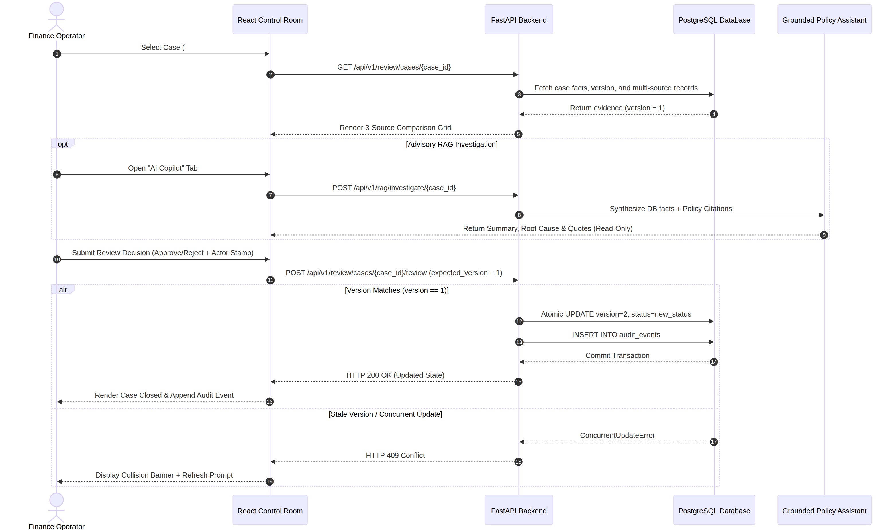
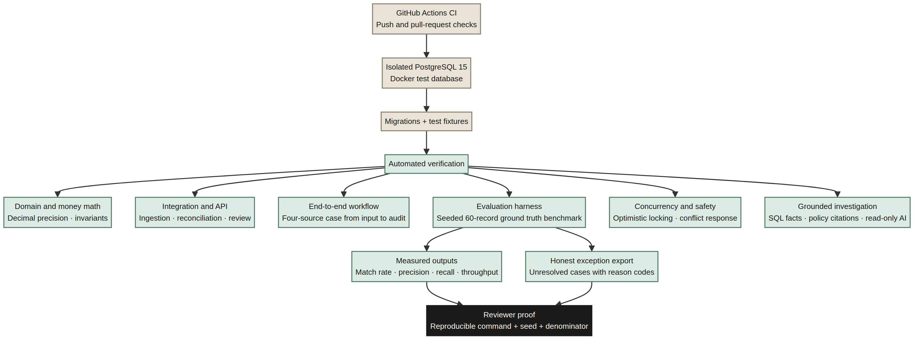

# LedgerLens Reviewer Guide

This is the reviewer-facing evidence map for the Razorpay Buildathon AI Finance Controller track. It is designed to help a judge understand the product quickly without reading every internal planning document.

## The one-minute explanation

> **LedgerLens is an evidence-first finance-operations control room. It reconciles payment, settlement, refund, bank-credit, and ledger records across a synthetic 50+ record batch, measures what it can match automatically, lists what it cannot resolve, and gives a human reviewer the evidence to make and audit the next decision.**

The project is deliberately narrow. It does not try to be a general chatbot, a forecasting suite, or an autonomous money-moving agent. It closes one finance-operations loop and makes the result measurable.

## What a Razorpay reviewer should be able to verify

| Reviewer question | LedgerLens evidence |
|---|---|
| Does it solve a real finance-operations problem? | Four-source reconciliation from payment to bank-credit evidence, with exception routing |
| Does it meet the 50+ record requirement? | Seeded synthetic benchmark with a 60-record baseline and a second-fixture verification plan |
| Is the result measured rather than asserted? | Match rate, precision, recall, throughput, false approvals, amount at risk, and exception export |
| Does it know when it cannot decide? | `needs_review`, unresolved cases, explicit exception categories, and an honest exception list |
| Is the AI safe in a financial workflow? | Deterministic arithmetic owns financial truth; RAG is read-only and evidence-grounded |
| Can a human operate it? | Queue triage, plain-language reason, four-source case dossier, decision panel, and audit trail |
| Is it engineered with care? | Decimal arithmetic, PostgreSQL persistence, idempotency, optimistic locking, CI, and failure-state design |
| Is the student honest about the prototype? | Clear status table, synthetic-data disclaimer, security limitations, and pending authentication/public-demo gates |

## The three diagrams to keep

The project should retain all three diagrams, but each should have one job:

### 1. Product/system map — first impression

**File:** `docs/assets/ledgerlens-system-map.png`

Use this in the README. It is the vertical, readable overview: sources → validation → storage → deterministic reconciliation → automatic matches or exceptions → evaluation/review → human decision → audit history.

### 2. Operator review workflow — how the product is used

**Source:** `docs/assets/review-workflow.mmd`

Use this in the architecture or demo documentation. It shows the operator, React control room, FastAPI backend, PostgreSQL, and read-only policy assistant, including the optimistic-locking conflict path. This is the strongest diagram for proving that the product is more than a static dashboard.

### 3. Evaluation and test evidence — how claims are proved

**Source:** `docs/assets/testing-evidence.mmd`

Use this in the evaluation documentation. It shows the CI/database/test path, benchmark outputs, and coverage areas. It should use current verified wording rather than a stale hard-coded test count.

The older `docs/assets/architecture-overview.mmd` should remain as a detailed engineering source, but it does not need to appear in the README. Four diagrams are useful internally; three are the correct reviewer-facing set.

## JPMC research: how to highlight it correctly

The repository contains a research reference connecting LedgerLens design choices to publicly available J.P. Morgan AI Research material on synthetic data and financial agent methodology. This is valuable because it explains why the project emphasizes relationally coherent synthetic records, deterministic numeric tools, bounded AI, and supervisory human review.

The safe reviewer wording is:

> I used publicly available J.P. Morgan AI Research material as design guidance for synthetic-data quality and the AI boundary. It influenced my decision to keep financial arithmetic and source facts in deterministic code and use AI for grounded explanation. LedgerLens is not affiliated with, endorsed by, or validated by J.P. Morgan Chase.

The research should support the design rationale, not replace LedgerLens evidence. The benchmark must be reproducible from the repository, and the application must not claim that JPMC reviewed the product unless that is explicitly authorized and documented.

Before public submission, audit `docs/RESEARCH_REFERENCES.md` so every JPMC claim is tied to a specific public source, a date, and a precise LedgerLens design decision. Avoid phrases such as “gold standard,” “guarantees,” or “we implemented JPMC’s framework” unless the source directly supports those exact claims.

## UI/UX evidence that matters to judges

The UI/UX work is relevant when it is tied to operator outcomes. It should not be presented as a decorative design exercise.

The strongest points to highlight are:

- The queue is exception-first, so the operator sees what needs attention rather than decorative dashboard KPIs.
- Each row states what happened in plain language before showing the technical exception code.
- Monetary values and identifiers use a stable tabular treatment so reviewers can compare amounts quickly.
- The case workspace keeps context, multi-source evidence, and decision controls close together.
- The AI panel is visually secondary and contains no approval control.
- Loading, empty, filtered-empty, partial-evidence, success, and HTTP 409 conflict states are designed as explicit product states.
- The review decision is separated from AI advice, which makes the human-in-the-loop boundary visible.

This is the UI/UX thesis to use in the pitch:

> LedgerLens is designed as a calm investigation workspace, not a generic AI chat screen. The interface moves an operator from risk signal to evidence to human decision without losing context.

## What belongs in the README

Keep the README focused on a five-minute reviewer journey:

1. One-sentence product explanation.
2. Track 04 fit.
3. The complete workflow.
4. The deterministic-first, AI-second trust boundary.
5. Current benchmark evidence with denominator and seed.
6. The vertical system map.
7. A short UI/UX rationale.
8. Quickstart and test commands.
9. Current status and honest limitations.
10. Links to the reviewer guide, evaluation methodology, demo script, application outline, research references, and architecture details.

## What should stay out of the README opening

The full competitor matrix should not appear in the README opening. It is useful as internal strategy and can remain in `docs/COMPETITOR_ANALYSIS.md`, but a judge should see what LedgerLens built and proved before seeing a long comparison against other repositories.

The five-minute demo script should remain in `docs/demo-script.md`, linked from the README. It is a production aid for recording, not the product explanation itself.

The application outline should remain in `docs/application-outline.md`, linked from the README. It is submission preparation, not a core product document.

The JPMC research reference should remain a concise supporting source, linked from the README through this guide. It should inform the design story without dominating it.

## Final reviewer-facing evidence order

1. README hero and LedgerLens visual preview.
2. One-minute explanation and Track 04 mapping.
3. Benchmark table and honest exceptions.
4. Vertical system map.
5. Working control-room walkthrough.
6. Four-source case evidence.
7. Read-only policy explanation.
8. Human decision and audit history.
9. CI/test/evaluation proof.
10. Research-informed design rationale.
11. Limitations and next hardening step.

That order gives the reviewer product clarity first, proof second, engineering depth third, and research context fourth.
